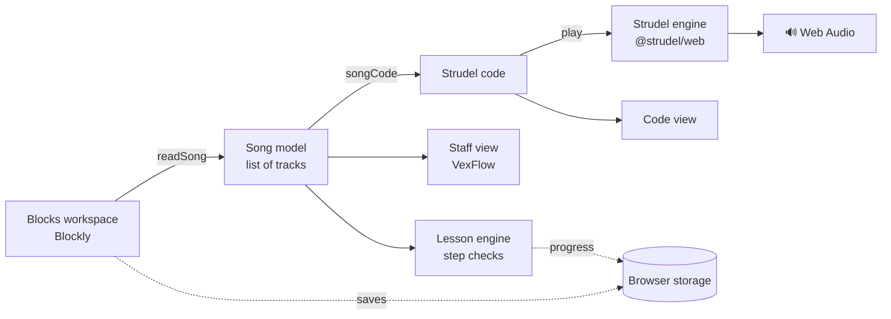

# Architecture

StrudelBites is a single web page with no server. Everything runs in the browser.



## The song model

The heart of the app. Blocks are read into a plain list of tracks (`src/blocks/model.js`):

```js
[
  { kind: 'beat', sound: 'bd', steps: '1010' },
  { kind: 'melody', instrument: 'triangle', notes: [{ pitch: 'c4', len: 'h' }] },
]
```

Three things read it, so none of them need to know about Blockly:

| Reader | Output |
| --- | --- |
| `songCode()` | Strudel code, e.g. `stack(s("bd ~ bd ~"), note("c4@2 e4").s("triangle"))` |
| `renderStaff()` | Music notation (treble staff for melodies, percussion staff for drums) |
| Lesson `check(ctx)` | Whether the learner has finished the current step |

## Time

One Strudel **cycle** is one **bar of 4/4**. Beat blocks split a bar into 4 or 8 steps. Melodies are written with `@` weights in eighth notes; if a melody is longer or shorter than a bar it is slowed with `.slow(bars)` so a quarter note always lasts one beat.

## Play-along

The code that is *played* has hidden hooks that the code learners *see* does not: each sound-making track gets `.onTrigger(__sbHit(n), false)`. Strudel calls it a moment before each sound; the engine waits until the sound is heard, then reports `(track, time)`. `eventAt()` in the song model works out which note or step that was, and the matching block, beat square and staff note light up. Clef dances in time while music plays.

## Volume safety

`engine/strudel.js` routes Strudel's output through a limiter and a 75% master volume, so no combination of blocks can get painfully loud.

## Lesson engine

Lives in `Studio.svelte`. After every change it builds `{ tracks, code, playing, listened, panel }` and calls the current step's `check()`. When it returns true, Clef cheers and the next step starts. Steps can also be `listen` (press Listen) or `confirm` (press "I see it").

## Folders

| Folder | Contents |
| --- | --- |
| `src/blocks` | Block shapes, the song model, Blockly setup |
| `src/engine` | The Strudel wrapper |
| `src/lessons` | One file per lesson, plus checks |
| `src/staff` | Notation rendering |
| `src/components` | Svelte screens |
| `src/lib` | State, storage, speech, translations, code highlighting |
| `src/locales` | All text, per language |

## Decisions

- **Svelte 5 + Vite**: little code to read; fast on iPad.
- **Picture-first, voice-first UI**: the first learner is 6.
- **No accounts**: progress stays in the browser.
- **AGPL-3.0**: required by Strudel, and right for an open teaching tool.
